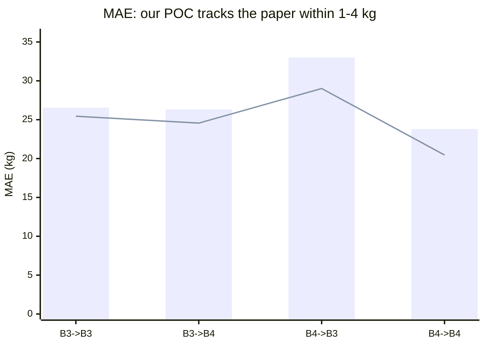
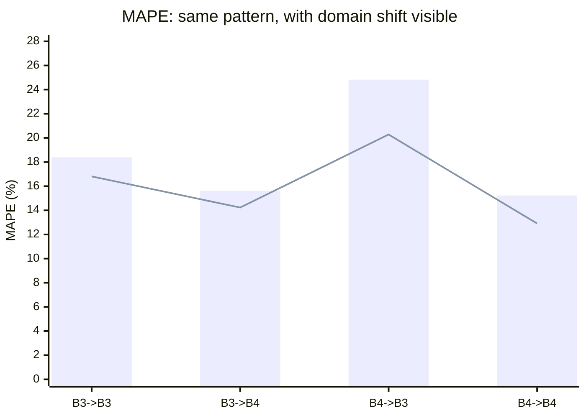
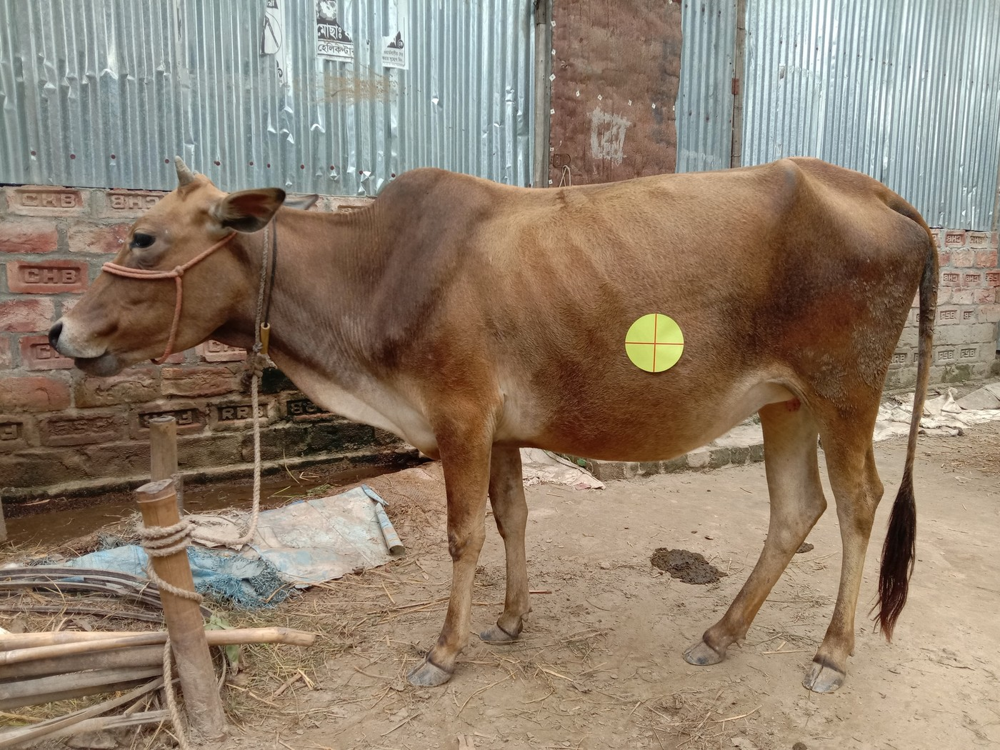
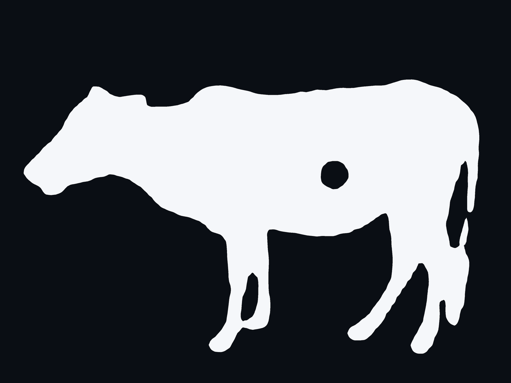
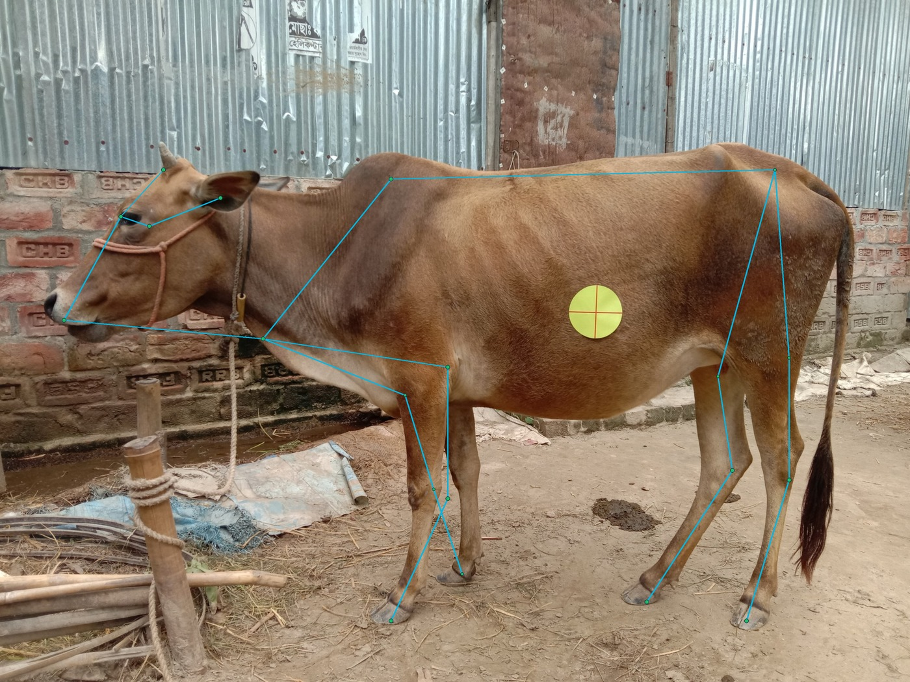
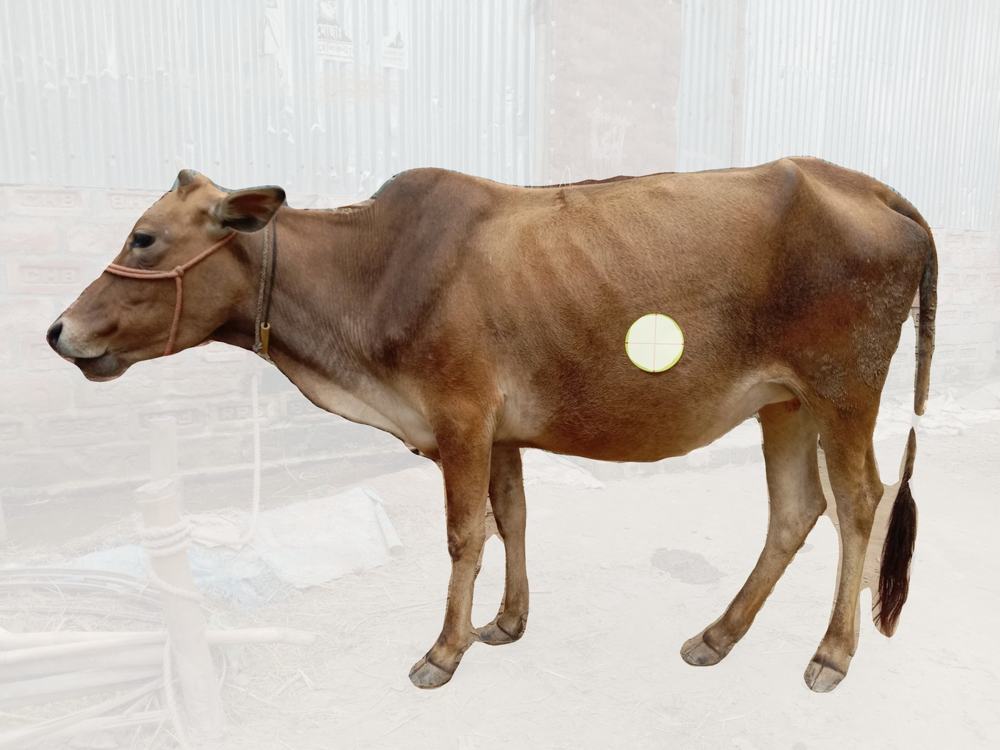
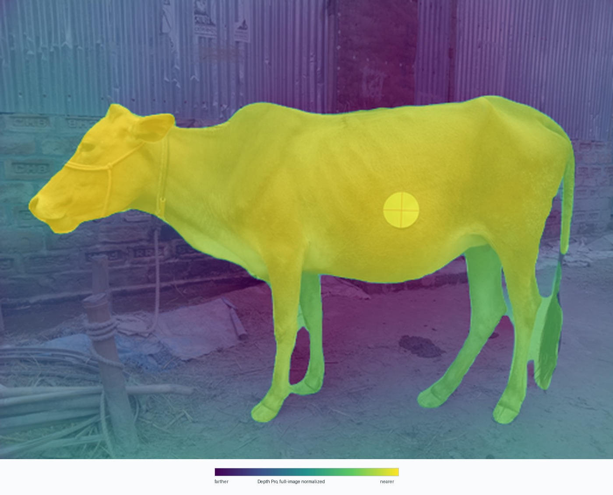

# Bovine Weight Estimation Proof of Concept

**Decision: ship the proof of concept.**

We reproduced a paper-style cattle weight estimation pipeline from 2D side-view images and reached benchmark-level performance close enough to justify a stakeholder demo and field pilot. Across the four B3/B4 train and evaluation settings, our model is within **1.10 to 3.99 kg MAE** of the paper. Average error is **27.43 kg MAE** versus **24.87 kg MAE** in the paper, a **2.56 kg average gap**.

This is not a production calibration claim yet. It is a strong proof that the core workflow works: a single calibrated side-view image can produce useful cattle weight estimates without a physical scale, depth camera, or manual tape measurement.

## Executive Readout

| Signal | Takeaway |
| --- | --- |
| Best absolute result | **23.80 kg MAE** on B4 -> B4 |
| Best benchmark match | **B3 -> B3**, only **+1.10 kg MAE** versus the paper |
| Most encouraging transfer | **B3 -> B4** at **26.35 kg MAE**, essentially matching B3 same-dataset performance |
| Hardest case | **B4 -> B3** at **33.00 kg MAE**, still within **+3.99 kg** of the paper |
| Ship call | Good enough for a POC demo, not yet a production guarantee |

## The B3/B4 Datasets

B3 and B4 are the two side-view cattle image cohorts used by the paper benchmark and by this reproduction. They are not just arbitrary labels; they behave like two related but different operating conditions for the model. That is why we report both same-dataset performance and cross-dataset transfer.

| Dataset | Indexed images | Weight range | Mean / median weight | Strict-run usable split | Why it matters |
| --- | ---: | ---: | ---: | ---: | --- |
| B3 | 2,601 | 36-621 kg | 157.0 / 152.0 kg | 2,080 train / 519 test | Broader weight range; stresses generalization at the light and heavy ends |
| B4 | 1,943 | 69-307 kg | 166.8 / 166.0 kg | 1,552 train / 388 test | Narrower range; useful for checking whether the model transfers to a related cohort |

The model is evaluated in four directions:

- **B3 -> B3:** train and test within B3.
- **B4 -> B4:** train and test within B4.
- **B3 -> B4:** train on B3, evaluate transfer to B4.
- **B4 -> B3:** train on B4, evaluate transfer to B3.

The cross-dataset cases are the most important proof-of-concept signal. They tell us whether the model learned animal shape and scale cues that survive a cohort change, rather than only memorizing one dataset's visual quirks.

## Headline Results

| Train -> eval | Ours MAE / MAPE | Paper MAE / MAPE | Absolute gap | Relative gap |
| --- | ---: | ---: | ---: | ---: |
| B3 -> B3 | 26.55 kg / 18.39% | 25.45 kg / 16.81% | +1.10 kg / +1.58 pp | +4.3% MAE, +9.4% MAPE |
| B3 -> B4 | 26.35 kg / 15.62% | 24.56 kg / 14.23% | +1.79 kg / +1.39 pp | +7.3% MAE, +9.8% MAPE |
| B4 -> B3 | 33.00 kg / 24.82% | 29.01 kg / 20.28% | +3.99 kg / +4.54 pp | +13.8% MAE, +22.4% MAPE |
| B4 -> B4 | 23.80 kg / 15.23% | 20.46 kg / 12.91% | +3.34 kg / +2.32 pp | +16.3% MAE, +18.0% MAPE |





## Residuals by Animal Weight

We are **not wrong across the board**. The residuals show a clear, useful pattern: the model is strongest in the middle of the observed weight range, tends to **overpredict lighter animals**, and tends to **underpredict heavier animals**.

Residual sign convention: `residual_kg = actual_kg - predicted_kg`. Positive residuals mean the model predicted too low. Negative residuals mean the model predicted too high.

| Train -> eval | Overall mean residual | Lightest quartile | Middle quartiles | Heaviest quartile | Readout |
| --- | ---: | ---: | ---: | ---: | --- |
| B3 -> B3 | -0.25 kg | -29.2 kg | -9.7 to +2.5 kg | +37.1 kg | Well-centered overall, but compressed toward the mean |
| B3 -> B4 | +11.6 kg | -11.2 kg | +4.0 to +15.5 kg | +39.6 kg | Transfers well, but heavier B4 animals are underpredicted |
| B4 -> B3 | -13.9 kg | -53.3 kg | -27.2 to -9.0 kg | +36.2 kg | Hardest transfer; light B3 animals are overpredicted |
| B4 -> B4 | +1.31 kg | -31.2 kg | -7.2 to +6.9 kg | +38.7 kg | Well-centered overall, with the same light/heavy compression |

This is actually a good POC signal. The model is not randomly failing; it has a diagnosable calibration bias. In product terms, that is much easier to improve than chaotic error. The next iteration should focus on reducing this weight-range compression with more high- and low-weight examples, weight-stratified validation, and a post-model calibration step.

The same pattern explains why MAPE is higher on lighter animals. A 25 kg miss is a much larger percentage error on a 100 kg animal than on a 220 kg animal, so percentage error can look worse even when absolute error is operationally comparable.

## Why This Is Captivating

The important result is not that we exactly copied the paper. The important result is that we built a working end-to-end version of the same idea and landed in the same performance band.

The strongest story is B3 -> B4. A model trained on B3 transferred to B4 at **26.35 kg MAE**, almost identical to its B3 same-dataset result of **26.55 kg MAE**. That suggests the pipeline is learning real body-shape signal, not just memorizing one cohort.

The B4 -> B3 direction is the hardest transfer case, which is expected in a POC: cross-dataset generalization exposes differences in animal distribution, image conditions, segmentation quality, and calibration. Even there, the miss is measured in a few kilograms relative to the paper benchmark, not a collapse of the method.

## Method Summary


1. **Image indexing:** We index B3/B4 side-view images and parse ground-truth weights from filenames or metadata-like names.
2. **Scale normalization:** A colored circular sticker is detected and every image is normalized to a fixed sticker radius. This gives the model a consistent pixel-to-body scale.
3. **Computer vision extraction:** The pipeline produces cattle masks, AnimalPose-style keypoints, depth maps, and point-cloud-derived shape features.
4. **Feature engineering:** We extract the 84 named paper-style features, spanning body measurements, mask geometry, contour statistics, point-cloud geometry, and keypoint distances.
5. **Modeling:** We fit feature filtering, imputation, scaling, and LASSO on training rows only, then evaluate on held-out same-dataset and cross-dataset cases.
6. **Benchmarking:** We report MAE and MAPE against the paper's B3/B4 results, including both same-dataset and transfer settings.

## Preprocessing Gallery

One representative B3 sample shows the actual preprocessing story. These are not conceptual mockups; they are generated from the strict reproduction artifacts for `B3:B3/images/120_s_140_F.jpg`.

| Stage | Image | What it proves |
| --- | --- | --- |
| Raw side-view input |  | A normal field image contains enough visible body geometry and a calibration sticker. |
| Sticker calibration |  | The sticker gives the pipeline a real scale anchor before feature extraction. |
| PVTv2 mask |  | The frozen PVTv2-B2 saliency mask isolates the body silhouette for area, contour, and shape features. |
| Pose landmarks |  | Keypoints provide body length, height, and anatomical distance measurements. |
| Depth-ready crop |  | The animal is isolated before depth and point-cloud features are derived. |
| Depth Pro output |  | The depth map is visualized with a full-image-normalized color scale before point-cloud features are derived. |

The implementation also includes a simple Heart Girth Model baseline:

```text
kg = ((heart_girth_in^2 * body_length_in) / 300) * 0.45359237
```

That baseline is useful as a sanity check, but the POC result above is driven by the paper-style LASSO workflow.

## Product Vision

The POC is the scientific anchor. The product vision is bigger: move from a sticker-based paper reproduction to a **no-sticker, image-only cattle weight estimator** that works from a side-view image or short video, with optional metadata such as sex, breed/type, age class, device, EXIF, and capture environment.

The critical distinction is simple:

- **Training can use sale-barn scale weights and manual body measurements.**
- **Production inference cannot use true body measurements, sale weight, lot average, stickers, rulers, or marker fields.**

The path forward is a two-track program:

| Track | Purpose | Why it matters |
| --- | --- | --- |
| Paper reproduction | Stay close to the B3/B4 sticker pipeline: sticker scale, PVTv2 mask, keypoints, Depth Pro, point clouds, engineered features, NMI filtering, and benchmark models. | Gives us a defensible scientific baseline and explains how close we are to the published result. |
| No-sticker product | Replace sticker scale with learned measurement prediction, predicted-HGM, residual correction, uncertainty, and accept/reject logic. | Turns the research workflow into something an end user can run from ordinary images or short videos. |

The target MVP remains feature-driven and auditable, not a large black-box end-to-end model. The production pipeline should look like this:

```mermaid
flowchart LR
    A["Image or short video"] --> B["QA and best frame"]
    B --> C["Segmentation + keypoints"]
    C --> D["Depth Pro + point cloud"]
    D --> E["Shape, depth, QA, device features"]
    E --> F["Predicted body measurements"]
    F --> G["Predicted HGM base weight"]
    G --> H["Residual correction"]
    H --> I["Weight + interval + accept/reject"]
```



The product output should be explicit and auditable: `weight_estimate_kg`, `prediction_interval_kg`, `quality_status`, `retake_reason`, predicted body measurements, predicted-HGM weight, residual correction, and `model_version`.

The roadmap is practical:

1. **Finish the paper-faithful anchor:** broaden models beyond LASSO where useful, keep strict artifact traceability, and explain any remaining paper gap.
2. **Run the no-sticker ablation:** inpaint/remove stickers, remove sticker-derived fields, quantify the sticker-vs-no-sticker gap, and stress test resolution, compression, blur, and padding.
3. **Ingest sale-barn data safely:** schema-first tables for animals, events, sessions, frames, labels, CV artifacts, features, predictions, and duplicate controls.
4. **Build the measurement-supervised MVP:** predict body measurements out-of-fold, compute predicted-HGM, then train a residual model using image-derived, depth, QA, and optional metadata features.
5. **Validate like a product:** hold out ranches, barns, sale events, dates, animals, sessions, and videos; report MAE, MAPE, RMSE, interval coverage, rejection rate, subgroup bias, and device/resolution bias.
6. **Pilot with governance:** log model version, feature schema version, QA flags, predictions, intervals, rejection reasons, and enough metadata to reproduce every prediction.

The non-negotiables are the right ones: leakage controls, animal/session/event splits, no-sticker ablation, cross-fitted measurement prediction, uncertainty/rejection, and device/resolution stress testing. Those are not overhead; they are what make the product credible outside a demo.

The optimistic timeline is also realistic: an internal MVP is plausible in roughly **8-9 weeks** if sale-barn labels and images arrive early. An external pilot is more likely **12+ weeks**, because validation, leakage controls, device robustness, and rejection behavior have to be right before customers rely on it.

## What We Can Say With Confidence

This POC validates the technical path:

- A side-view image can be converted into calibrated biometric features.
- The extracted features are predictive enough to approach the paper benchmark.
- Same-dataset and cross-dataset tests both produce useful error levels.
- The implementation is traceable: method docs, feature summaries, model artifacts, and reproduction reports are written to the repo.
- The remaining gap is small enough to justify a field pilot instead of more desk research.

## What We Should Not Overclaim

This is not ready to replace scales in production. The next phase needs broader validation before operational use:

- Larger untouched test set across farms, cameras, lighting, breeds, and animal sizes.
- A locked capture protocol for side-view angle, distance, sticker placement, and occlusion.
- Confidence intervals and failure-mode tagging for poor masks, pose misses, blurry images, and unusual posture.
- A field comparison against real scale weights collected close to image capture time.
- Product packaging: API or demo UI, quality gates, and a clear operator workflow.

## Suggested Boss Demo Narrative

1. Start with the business problem: weighing cattle is operationally expensive, slow, and hard to do frequently.
2. Show the input: one side-view image plus a visible calibration sticker.
3. Show the transformation: sticker normalization, animal mask, pose landmarks, depth/shape features.
4. Show the result: **23.80-33.00 kg MAE** across B3/B4 evaluation directions.
5. Close with the decision: the method is accurate enough to demo and pilot; the next milestone is field validation.

## Supporting Repo Evidence

- Method detail: [`docs/reproduction_method.md`](reproduction_method.md)
- Known limits and reproduction assumptions: [`docs/known_limitations.md`](known_limitations.md)
- Strict-run dataset summary: [`runs/reproduction_b3_b4_strict/reports/b3_b4_dataset_summary.csv`](../runs/reproduction_b3_b4_strict/reports/b3_b4_dataset_summary.csv)
- Preprocessing gallery assets: [`docs/assets/poc_preprocessing/`](assets/poc_preprocessing/)
- Strict-run predictions and residuals: [`runs/reproduction_b3_b4_strict/reports/predictions.csv`](../runs/reproduction_b3_b4_strict/reports/predictions.csv)
- Strict-run metrics: [`runs/reproduction_b3_b4_strict/reports/reproduction_metrics.md`](../runs/reproduction_b3_b4_strict/reports/reproduction_metrics.md)
- Evaluation gate status: [`reports/headline_reproduction_status.md`](../reports/headline_reproduction_status.md)
- Generated feature summaries: [`reports/feature_summary.csv`](../reports/feature_summary.csv)
- Generated diagnostic figures: [`reports/figures/`](../reports/figures/)
